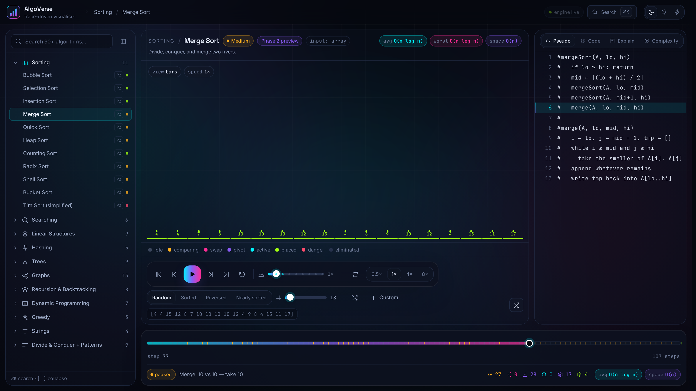
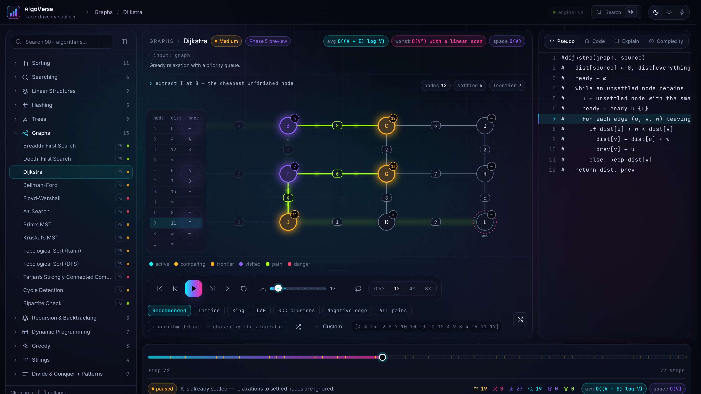
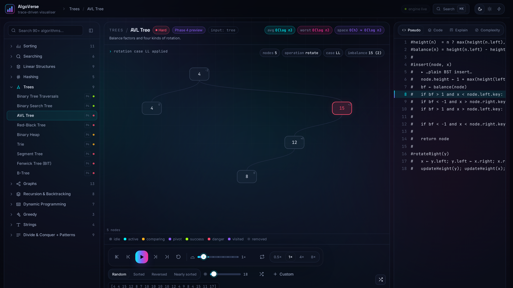
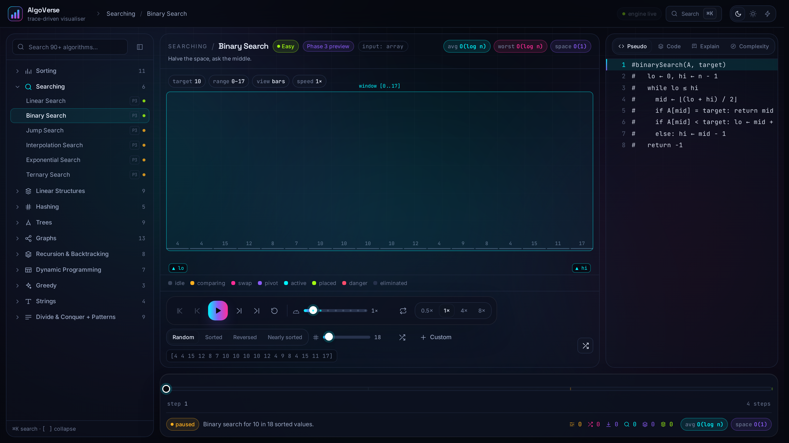
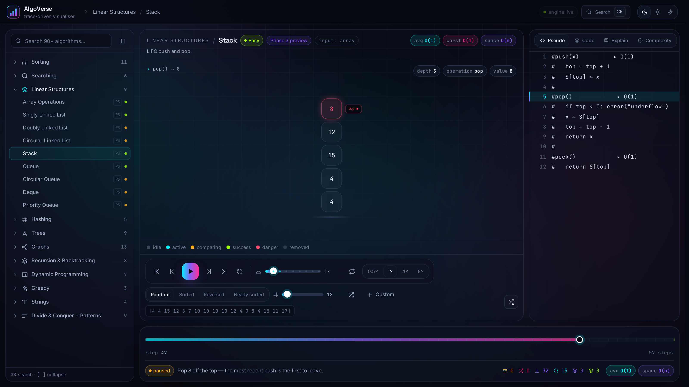
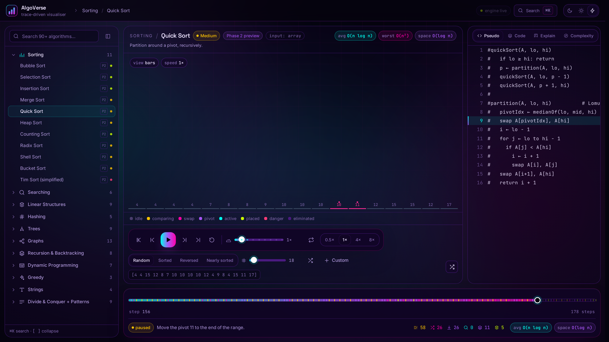

<!--
  AlgoVerse — README
  Hero is a self-contained animated SVG (CSS keyframes, honours prefers-reduced-motion).
-->

<div align="center">



# AlgoVerse

**A cinematic, trace-driven visualiser for data structures and algorithms.**
Watch every comparison, swap, probe and backtrack — scrubbed, replayed, explained.

[](LICENSE)
[](#testing--quality-gates)
[](tsconfig.app.json)
[](#coverage)
[](CONTRIBUTING.md)

`React 18` · `Vite` · `TypeScript (strict)` · `Tailwind + CSS variables` · `Framer Motion` · `Zustand` · `SVG + Canvas`

</div>

---

## Why this is not another sorting-animation toy

Most visualisers run the algorithm *inside* the render loop: change the input, and the animation you were watching is gone. AlgoVerse splits the problem in two.

**A generator is a pure function.** It walks its own data structure and records what it did as an immutable list of snapshots — a `Trace<State, Data>` — and never touches the DOM. **The UI is a replayer.** It renders `steps[cursor]` and nothing else. Zero algorithm logic lives in a component.

That single rule is why rewinding, scrubbing, 8× playback, step-by-step pseudocode sync, live metrics, shareable URLs, GIF export and browser-free unit tests are all *free* for every algorithm in the app rather than features bolted onto each one:

| Capability | Why it falls out of the architecture |
| --- | --- |
| Scrub / step back / jump to end | `steps[cursor]` is an array index — the algorithm is never re-run |
| Playback 0.25×–8× | Each step carries a `weight`; a pure time model turns that into milliseconds |
| Metrics (comparisons, swaps, writes, reads, depth) | `TraceBuilder.bump()` accumulates per step, so a metric is a snapshot, not a counter you have to trust |
| Pseudocode **and** JS / Python / C++ / Java sync | `pseudocodeLine` / `codeLine` are step fields, mapped across languages by one derived table |
| Timeline heat-map & jump-to-event | Step `kind` → colour, computed at render time |
| Shareable URL state, PNG / SVG / GIF export | A trace is plain, serialisable data |
| 531 unit tests without a browser | Generators are pure functions of `(input, run)` |

---

## Screenshots

| Sorting — FLIP-animated bars | Graphs — energy on the relax edge |
| --- | --- |
|  |  |

| Trees — rotations shown as arcs | Searching — bracket collapsing |
| --- | --- |
|  |  |

| Linear structures — stack, queue, deque | Cyberpunk theme |
| --- | --- |
|  |  |

<sub>Regenerate these with `npm run screenshots` (Playwright drives the real app).</sub>

---

## Quick start

```bash
git clone https://github.com/<your-username>/algoverse.git
cd algoverse
npm install
npm run dev          # http://localhost:5173
```

Everything else:

```bash
npm run test         # 531 unit + DOM tests (Vitest)
npm run typecheck    # tsc --noEmit — strict, zero `any`
npm run build        # tsc -b && vite build
npm run preview      # serve the production build
npm run screenshots  # regenerate docs/media/*.png from the running app
npm run verify       # typecheck + test + build — the gate CI runs
```

### Keyboard

| Key | Action |
| --- | --- |
| `Space` | play / pause |
| `←` `→` | step one frame |
| `Shift` + `←`/`→` | jump 10 frames |
| `Shift` + `E` | copy a shareable link to this frame |
| `Home` `End` | first / last frame |
| `R` | reset to frame 0 |
| `+` `−` | playback speed |
| `L` | loop the trace |
| `K` / `⌘K` / `Ctrl+K` | command palette |
| `[` `]` | collapse / expand the sidebar |

---

## Architecture

```text
                            ┌──────────────────────────────┐
                            │  /algorithms   (PURE)        │
                            │  generate(input, run)        │
                            │    → Trace<State, Data>      │
                            │  no DOM · no React · no I/O  │
                            └───────────────┬──────────────┘
                                            │ Trace = Step[] (immutable snapshots)
                                            ▼
   ┌────────────────────────────────────────────────────────────────────────┐
   │  /engine                                                               │
   │   registry.ts   lazy module loading + prefetch + cache                 │
   │   catalogue.ts  84 catalogue entries: search, difficulty, phases       │
   │   playback.ts   PURE reducer + time model (speed, weights, advance)    │
   └───────────────┬────────────────────────────────────────────────────────┘
                   │ cursor + metrics + highlights
                   ▼
   ┌────────────────────────────────────────────────────────────────────────┐
   │  /store (Zustand)                                                      │
   │   playbackStore  cursor · status · speed · loop · trace                │
   │   sessionStore   dataset preset, seed, custom values, saved inputs     │
   │   uiStore        sidebar, inspector tab, code language, palette        │
   │   themeStore     dark | light | cyberpunk (one attribute on <html>)    │
   │   fxStore        one-shot bursts → the single confetti canvas          │
   └───────────────┬────────────────────────────────────────────────────────┘
                   │ useTraceSession() · usePlaybackClock() (one rAF for all)
                   ▼
   ┌────────────────────────────────────────────────────────────────────────┐
   │  /visualizers                                                          │
   │   VisualizerFrame  the ONLY bridge: erases generics once, renders      │
   │                    exactly one TraceStep                               │
   │   Bar · Tree · Graph · Table · Call · Board · Hash · Interval · Sequence│
   └────────────────────────────────────────────────────────────────────────┘
```

### One trace shape, nine renderers

Generators do not each get a bespoke renderer. They emit one of nine **snapshot shapes** — array, sequence, tree, graph, table, call stack, board, hash table, intervals — and each shape has exactly one renderer that owns its motion, colour roles and sound. A new algorithm therefore inherits a finished, accessible, 60 fps visualisation by *choice of shape*, not by writing one:

| Snapshot shape | Renderer | Used by |
| --- | --- | --- |
| `ArraySnapshot` | `BarVisualizer` (FLIP) | sorting, searching, strings, windows, pointers, prefix sums |
| `SequenceSnapshot` | `SequenceVisualizer` | linked lists, stack, queue, deque, ring buffer, heap |
| `TreeSnapshot` | `TreeVisualizer` | BST, AVL, Red-Black, heap, trie, segment tree, Fenwick |
| `GraphSnapshot` | `GraphVisualizer` (Canvas glow) | BFS, DFS, Dijkstra, Bellman-Ford, Floyd-Warshall, A*, MST, SCC |
| `TableSnapshot` | `TableVisualizer` (dependency arrows + backtrack path) | dynamic programming, matrix chain |
| `CallSnapshot` | `CallVisualizer` | recursion: factorial, Fibonacci tree, Hanoi, subsets, permutations |
| `BoardSnapshot` | `BoardVisualizer` | N-Queens, Sudoku, Rat in a Maze |
| `HashSnapshot` | `HashVisualizer` | chaining, linear / quadratic / double probing, rehashing |
| `IntervalSnapshot` | `IntervalVisualizer` | activity selection, interval problems |

---

## Coverage

**68 of 84 catalogue entries are playable today**; the remaining 16 are roadmap placeholders that still replay a short trace, so no link is ever dead.

| Family | Playable | Catalogue | Contains |
| --- | :---: | :---: | --- |
| Sorting | **11** | 11 | bubble, insertion, selection, merge, quick, heap, shell, counting, radix, bucket, tim sort |
| Searching | **6** | 6 | linear, binary, jump, interpolation, exponential, ternary |
| Linear structures | **9** | 9 | array ops, singly / doubly / circular linked lists, stack, queue, circular queue, deque, priority queue |
| Trees | **9** | 9 | traversals (BFS/DFS/in-order), BST, AVL rotations, Red-Black, binary heap, trie, segment tree, Fenwick, B-tree |
| Graphs | **13** | 13 | BFS, DFS, Dijkstra, Bellman-Ford, Floyd-Warshall, A*, Prim, Kruskal + DSU, Kahn, DFS topo, Tarjan SCC, cycle detection, bipartite |
| Hashing | **5** | 5 | chaining, linear / quadratic / double probing, load factor + rehashing animation |
| Recursion & backtracking | **8** | 8 | factorial, Fibonacci recurrence tree, Tower of Hanoi, subsets, permutations, N-Queens, Sudoku solver, Rat in a Maze |
| Dynamic programming | **7** | 7 | Fibonacci tabulation, 0/1 knapsack, LCS, LIS, edit distance, coin change, matrix chain multiplication |
| Greedy | – | 3 | activity selection, Huffman coding, fractional knapsack *(next)* |
| Strings | – | 4 | KMP, Rabin-Karp, Z-algorithm, Boyer-Moore *(next)* |
| Misc / divide & conquer | – | 9 | union-find, sliding window, two pointers, prefix sum, monotonic stack, binary exponentiation, closest pair, sieve, GCD *(next)* |

Every playable algorithm ships with: pseudocode synced to the trace, four language implementations, a written explanation, a Complexity tab with best / average / worst, live metrics, and generator unit tests that assert the *algorithm's* own result (not just that it ran).

---

## Feature tour

**Playback that behaves like a video editor.** Play, pause, step either direction, scrub the timeline, jump to any event from the heat-map, loop, and change speed from 0.25× to 8× — all without ever re-executing the algorithm.

**Compare Mode.** Race two algorithms on the same input, one cursor driving both lanes, with a live metrics diff over comparisons, swaps, writes, reads and total steps. The losing lane fades instead of disappearing, so the divergence is visible.

**Learn Mode.** Every page carries an intro, real-world use cases, and a quiz derived from the algorithm's own metadata (time / space / odd-one-out) — no hand-written question bank to drift out of date.

**Four languages, one highlight.** The Code tab switches between JavaScript, Python, C++ and Java, always highlighting the line that matches the current step, because all four samples are line-aligned through one derived code map.

**Export.** Any frame as PNG (2×) or SVG, or the whole trace as an animated GIF — lazily loaded, so the exporters never touch the initial bundle.

**Inputs your way.** Random, sorted, reversed, nearly-sorted, custom values, CSV import, plus click-to-build for graphs and trees. State lives in the URL, so any view is a shareable link.

**Three themes.** Dark, Light and Cyberpunk, driven by one attribute on `<html>` and CSS custom properties — the aurora background reacts to the active algorithm.

**Built to be accessible and fast.** Full keyboard transport, ARIA roles on every control, focus rings, roving focus in the sidebar tree, `prefers-reduced-motion` honoured globally (movement is removed, information never is), one `requestAnimationFrame` loop for the whole app, transform/opacity-only animation, and Canvas only where it pays for itself.

---

## Project structure

```text
src/
  algorithms/     pure trace generators (register.ts = the lazy loader table)
    kit.ts        TraceBuilder, BarModel/charModel, code()+pseudo(), defineAlgorithm, finish
    sorting/ searching/ linear/ trees/ graphs/ hashing/ recursion/ dp/
  visualizers/    nine renderers + VisualizerFrame (the only generic bridge)
  components/     primitives · panels · transport · layout · cards · fx · hero · input
  store/          zustand stores (playback, session, ui, theme, toast, fx)
  hooks/          usePlaybackClock · useTraceSession · useKeyboardShortcuts · useSpotlight…
  engine/         registry · catalogue · playback (pure) · analysis
  utils/          TraceBuilder, dataset, format, math, highlight, export, cn
  visual/         role → token mapping (13 roles: idle/compare/swap/pivot/sorted/path…)
  styles/         tokens.css (3 themes) + globals.css (glass & neon layer)
  types/          trace.ts (the contract) · algorithm.ts (module shape) · visual.ts (snapshots)
  test/           traceContract.ts + jsdom shims
docs/
  PHASE-1.md      the original design decisions, kept for reference
  media/          screenshots + the animated hero above
```

---

## How to add a new algorithm in 5 steps

1. **Catalogue it** — one row in `src/engine/catalogue.ts`:
   `meta('kmp', 'Knuth–Morris–Pratt', 'strings', 'medium', 7, 'Failure links save the rescan.', ['pattern matching'])`.
   The sidebar, command palette, search, difficulty tags and counts pick it up automatically.
2. **Write the generator** — a pure function in `src/algorithms/<family>/`. Choose the snapshot shape that fits (array, tree, graph, table, call, board…), then:

   ```ts
   const spec: AlgorithmSpec<ArraySnapshot, SearchData> = {
     id: 'kmp',                       // must exist in the catalogue
     complexity: COMPLEXITY.kmp!,
     pseudocode: pseudo(`
   #kmp(text, pattern)
   #   build the failure table
   #   scan once, never rescan a character`),
     code: code(jsSource, pySource, cppSource, javaSource),   // line-aligned
     explanation: ['…'],
     defaultInput: () => ({ kind: 'string', text: 'abababca', pattern: 'abab' }),
     generate: (input, run) => {
       const model = charModel(textOf(input));
       const builder = new TraceBuilder<ArraySnapshot, SearchData>(() => model.snapshot({ … }));
       builder.emit({ kind: 'init', description: '…', pseudocodeLine: 0, codeLine: 0 });
       // record work: builder.emit({ kind: 'compare', bump: 'comparisons', … })
       return finish({ builder, spec, input, run, result: { headline: '…', output: index },
                       expectedState: () => index === reference(text, pattern) });
     },
   };
   export const definition = defineAlgorithm(spec);
   export const module = defineModule({ definition, Visualizer: BarVisualizer });
   ```

   `finish()` derives id, name and category from the catalogue, so a generator can never disagree with the sidebar about what it is.
3. **Reuse a renderer.** If your state is one of the nine snapshot shapes, you are done — the existing renderer gives you motion, colour roles, sound and reduced-motion support for free. Only add a new visualiser for a genuinely new shape.
4. **Register it** — one line in `src/algorithms/<family>/index.ts` (dynamic import, so it stays in its own chunk) and add the family to the table list in `register.ts`.
5. **Test it** — call `assertTraceContract(trace)` from `src/test/traceContract.ts` (checks ordering, line bounds, metric monotonicity and the terminal kind), then assert the algorithm's *own* result against an independently written reference. Run `npm run verify`.

That is the whole loop: the architecture is designed so step 3 is usually "nothing" and step 5 is thirty lines.

---

## Tech stack

| Layer | Choice | Why |
| --- | --- | --- |
| Build | Vite + React 18 + TypeScript (strict, `verbatimModuleSyntax`) | Instant HMR, route- and algorithm-level code splitting |
| Styling | Tailwind + CSS custom properties, three themes | Tokens are the theme; components never hard-code a colour |
| Motion | Framer Motion (`layout`, shared layout, `AnimatePresence`, springs) | Shared-element page morphs and FLIP bars without hand-written transforms |
| State | Zustand | Small stores, no provider pyramid, readable selectors |
| Rendering | SVG for structures, Canvas for particles, glow and 500+ elements | Correct where it matters, cheap where it counts |
| Tests | Vitest (+ Testing Library, jsdom) | 531 tests, no browser required for generators |
| Automation | Playwright script for screenshots, GitHub Actions for `verify` | The published images come from the real app |

---

## Testing & quality gates

```bash
npm run verify   # typecheck → 531 tests → production build
```

- **531 tests across 17 files**, including a shared trace-contract suite that every generator must satisfy: step indices are contiguous, descriptions are non-empty, `pseudocodeLine`/`codeLine` stay in range *after* cross-language resolution, cumulative metrics never go backwards, and each trace opens with `init` and closes on a terminal kind.
- **Correctness, not smoke.** Each family asserts the algorithm's real output against a second, independently written implementation — brute force for knapsack and activity selection, a BFS for the maze, an exhaustive subset search for N-Queens, and so on.
- **Strict TypeScript with no `any`**, no unused locals or parameters, and type-only imports enforced by `verbatimModuleSyntax`.
- **CI** (`.github/workflows/ci.yml`) runs install → typecheck → test → build on every push and pull request.

---

## Roadmap

| Phase | Scope | Status |
| --- | --- | --- |
| 1 | Design system, trace types, playback engine, shell, transitions | ✅ shipped |
| 2 | Sorting ×11 + bar visualiser + metrics + pseudocode sync | ✅ shipped |
| 3 | Searching ×6, array ops, 3 linked lists, stack, queue, deque, PQ | ✅ shipped |
| 4 | Trees: traversals, BST, AVL, Red-Black, heap, trie, segment/Fenwick, B-tree | ✅ shipped |
| 5 | Graph canvas + 13 graph algorithms | ✅ shipped |
| 6 | Hashing ×5, recursion & backtracking ×8 (call stack, boards) | ✅ shipped |
| 7 | Dynamic programming ×7 ✅ · greedy, strings, divide & conquer | 🚧 in progress |
| 8 | Hero, Compare Mode, Learn Mode, command palette, sound, GIF/PNG export, themes | ✅ shipped |
| 9 | Performance pass, accessibility audit, docs, screenshots | 🚧 in progress |

Remaining work is deliberately listed rather than hidden: greedy (activity selection, Huffman, fractional knapsack), strings (KMP, Rabin-Karp, Z, Boyer-Moore) and the misc/divide-and-conquer set (union-find, sliding window, two pointers, prefix sum, monotonic stack, binary exponentiation, closest pair, sieve, GCD) currently render roadmap placeholders. Their catalogue entries, input kinds and route wiring already exist — they need generators, exactly as described above.

---

## Contributing

Contributions are welcome — especially new generators, since the architecture makes them unusually self-contained. Read [CONTRIBUTING.md](CONTRIBUTING.md) first; the short version is: run `npm run verify` before opening a PR, keep generators pure, and never put algorithm logic in a component.

- 🐛 [Report a bug or request an algorithm](.github/ISSUE_TEMPLATE/algorithm_request.yml)
- 💬 [Code of conduct](CODE_OF_CONDUCT.md) · 🔐 [Security policy](SECURITY.md)

---

## Running this locally only

AlgoVerse is deliberately **not deployed** and ships **no hosting configuration** — there is no Pages workflow, no Vercel/Netlify config and no live demo link, by choice. Clone it, `npm install`, `npm run dev`, and the whole thing runs on your machine.

## License

[MIT](LICENSE) © AlgoVerse contributors.
